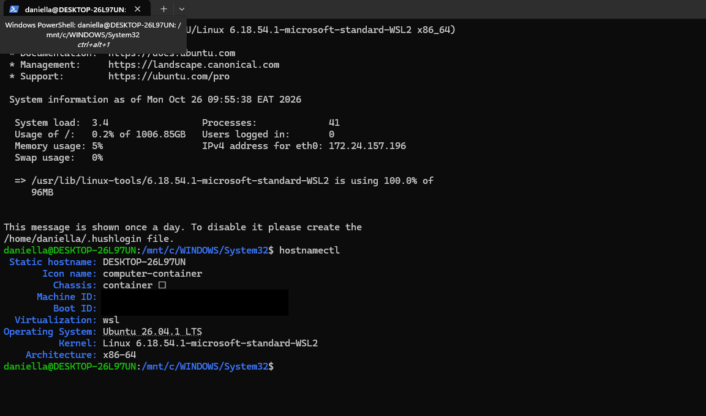
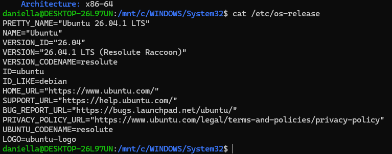
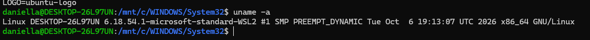
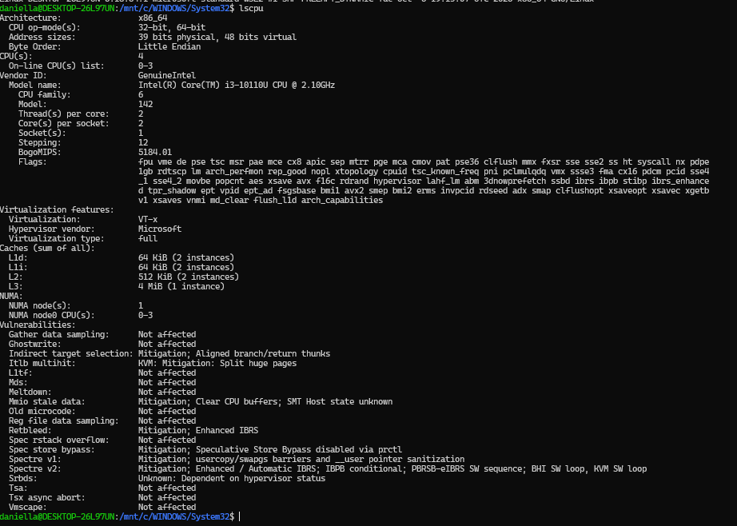
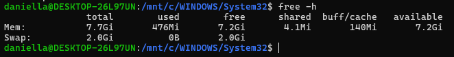
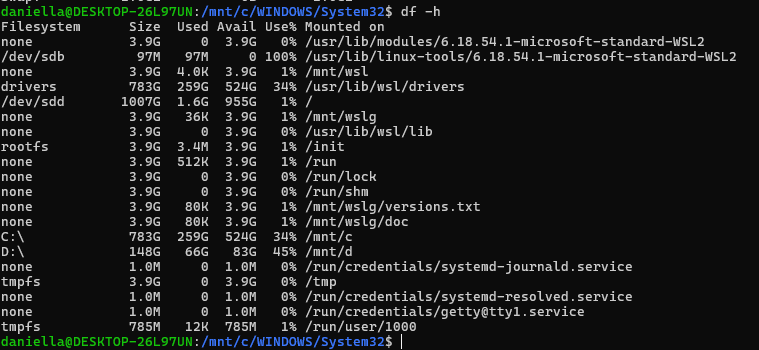
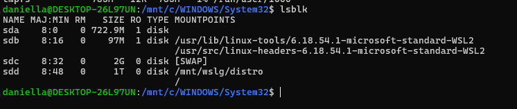
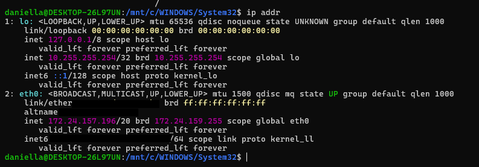
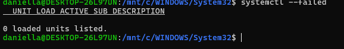
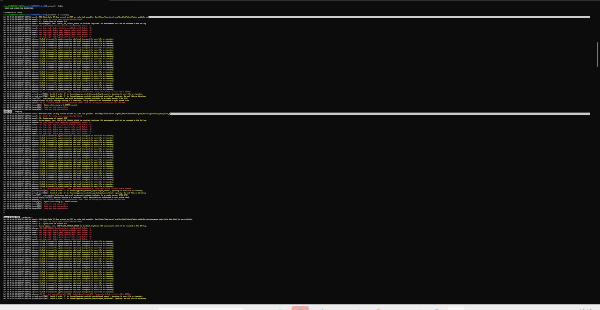

# Linux VM Administration and Diagnostics Report

| Field | Value |
|---|---|
| Student | Daniella Kyusa |
| GitHub username | Daniellakyusa |
| Issue | #N <!-- replace N with the Issue number --> |
| Branch | `docs/issue-N-vm-diagnostics` |
| Date of inspection | 26 October 2026 |
| Work area | Administration |

## 1. Objective

This report inspects a Linux environment, explains the output of standard administration commands, and documents two safe, read-only diagnostic investigations. No settings were changed, no services were stopped, and nothing was installed or deleted while gathering this evidence.

## 2. Environment note

I did not use a VirtualBox VM for this report. The system inspected is **Ubuntu 26.04.1 LTS running under WSL2** (Windows Subsystem for Linux 2) on my Windows laptop. WSL2 runs Linux inside a lightweight virtual machine managed by Microsoft's hypervisor. The system itself confirms this:

- `hostnamectl` reports `Virtualization: wsl` and `Chassis: container`.
- `lscpu` reports `Hypervisor vendor: Microsoft` and `Virtualization type: full`.

Some output differs from a full VM (for example, extra Windows drives in `df -h`, and several WSL-specific log messages). These differences are explained where they appear.

## 3. System summary

All values come from the command output in Section 4.

| Item | Observed value | Source command |
|---|---|---|
| Hostname | DESKTOP-26L97UN | `hostnamectl` |
| Virtualisation | wsl (container chassis) | `hostnamectl` |
| Distribution and version | Ubuntu 26.04.1 LTS (Resolute Raccoon) | `cat /etc/os-release` |
| Kernel | Linux 6.18.54.1-microsoft-standard-WSL2 | `hostnamectl`, `uname -a` |
| Architecture | x86-64 | `hostnamectl`, `lscpu` |
| CPU | Intel Core i3-10110U @ 2.10 GHz, 4 logical CPUs (2 cores, 2 threads per core) | `lscpu` |
| Memory | 7.7 GiB total, 7.2 GiB available | `free -h` |
| Swap | 2.0 GiB, 0 B used | `free -h` |
| Root filesystem (`/`) | 1007 GB on `/dev/sdd`, 1.6 GB used (1%) | `df -h` |
| Network | `eth0` is UP with IPv4 address 172.24.157.196/20 | `ip addr` |

## 4. Command review

### 4.1 `hostnamectl`

**Purpose:** Shows the hostname, operating system, kernel, architecture, and whether the machine is virtual or a container.

**Interpretation:** The static hostname is `DESKTOP-26L97UN`. The `Virtualization: wsl` and `Chassis: container` lines confirm this is a WSL environment rather than a standalone virtual machine. The operating system is Ubuntu 26.04.1 LTS on kernel `6.18.54.1-microsoft-standard-WSL2`, x86-64. The login banner above the command also shows low load: 41 processes, 5% memory use, and 0.2% of `/` used.

### 4.2 `cat /etc/os-release`

**Purpose:** Prints the distribution name, version, and codename from a standard system file.

**Interpretation:** The system is Ubuntu 26.04.1 LTS (codename "Resolute Raccoon", `VERSION_ID="26.04"`). `ID_LIKE=debian` shows it belongs to the Debian family, so it uses `apt` for package management.

### 4.3 `uname -a`

**Purpose:** Prints the kernel name, version, build information, and architecture on one line.

**Interpretation:** The output reads `Linux DESKTOP-26L97UN 6.18.54.1-microsoft-standard-WSL2 #1 SMP PREEMPT_DYNAMIC Tue Oct 6 19:13:07 UTC 2026 x86_64 GNU/Linux`. In order, this shows the kernel name (Linux), the hostname (`DESKTOP-26L97UN`, matching `hostnamectl`), the kernel release (`6.18.54.1-microsoft-standard-WSL2`), the build details (`#1 SMP PREEMPT_DYNAMIC`, built on 6 October 2026), the architecture (`x86_64`), and the operating system type (GNU/Linux). `SMP` means the kernel supports multiple CPUs, which fits the 4 logical CPUs seen in `lscpu`. The `microsoft-standard-WSL2` suffix shows this is the kernel supplied by Microsoft for WSL2, not an Ubuntu-built kernel.

### 4.4 `lscpu`

**Purpose:** Summarises the CPU as seen by the Linux system: model, core and thread counts, caches, virtualisation features, and known CPU vulnerabilities.

**Interpretation:** The system sees 4 logical CPUs (CPU(s): 4, listed as 0-3) on an Intel Core i3-10110U at 2.10 GHz, with 2 cores and 2 threads per core. `Hypervisor vendor: Microsoft` and `Virtualization type: full` confirm it is running on a Microsoft hypervisor. The Vulnerabilities section lists mitigations in place; one line, `Mmio stale data: Mitigation: Clear CPU buffers; SMT Host state unknown`, is relevant to a kernel warning discussed in Section 6.

### 4.5 `free -h`

**Purpose:** Shows total, used, free, and available memory and swap in human-readable units.

**Interpretation:** Total memory is 7.7 GiB, of which only 476 MiB is used and 7.2 GiB is available. "Available" is the more useful figure because it includes memory that can be reclaimed from the cache (140 MiB), whereas "free" counts only completely unused memory. The 2.0 GiB swap is entirely unused. Memory is healthy with no pressure.

### 4.6 `df -h`

**Purpose:** Shows size, used space, available space, and mount point for each mounted filesystem.

**Interpretation:** The root filesystem `/` is on `/dev/sdd`, 1007 GB in size with 1.6 GB used (1%) and 955 GB available. Several other entries are normal for WSL:

- `C:\` and `D:\` (mounted at `/mnt/c` and `/mnt/d`) are the Windows drives, shared into Linux.
- `none`, `tmpfs`, `rootfs`, and `/run/...` entries are small in-memory filesystems.
- `/dev/sdb` (97 MB) shows **100% used**. This is investigated in Scenario 1 (Section 5.1).

### 4.7 `lsblk`

**Purpose:** Lists block devices (virtual disks), their sizes, whether they are read-only (RO), and where they are mounted.

**Interpretation:** Four virtual disks are visible:

| Device | Size | RO | Mount point(s) |
|---|---|---|---|
| `sda` | 722.9 MB | 1 | none shown |
| `sdb` | 97 MB | 1 | `/usr/lib/linux-tools/6.18.54.1-microsoft-standard-WSL2` and `/usr/src/linux-headers-6.18.54.1-microsoft-standard-WSL2` |
| `sdc` | 2 GB | 0 | `[SWAP]` |
| `sdd` | 1 TB | 0 | `/mnt/wslg/distro` and `/` |

`sdd` is the main Ubuntu disk, `sdc` is swap, and `sda` and `sdb` are small **read-only** disks (RO = 1).

### 4.8 `ip addr`

**Purpose:** Shows network interfaces, their state, and their IP addresses.

*Redaction: the MAC address, the interface alternative name, and the IPv6 link-local address (which is derived from the MAC address) were blacked out.*

**Interpretation:** Two interfaces are present:

- `lo` (loopback) is UP with `127.0.0.1/8` and `::1/128`, as normal. It also carries `10.255.255.254/32`; the output does not say why (see assumption in Section 7).
- `eth0` is **UP**, with IPv4 address `172.24.157.196/20` and broadcast `172.24.159.255`. A private address in this range is typical of WSL2's virtual network. The interface is connected and has an address.

### 4.9 `systemctl --failed`

**Purpose:** Lists systemd services (units) that have failed.

**Interpretation:** The output reads `0 loaded units listed`, so **no services have failed**. It also confirms that systemd is running in this WSL instance, since `systemctl` would otherwise return an error.

### 4.10 `journalctl -b -p warning`

**Purpose:** Shows log messages from the current boot at warning priority or higher.

**Interpretation:** The log contains many warning and error lines, but they fall into a small number of groups, all of which are classified in Section 6. None of them corresponds to a failed service (`systemctl --failed` is empty). Warnings seen include:

- PCI messages (`PCI: Fatal: No config space access function found`, `PCI: System does not support PCI`)
- a kernel notice about an MMIO Stale Data CPU bug
- `dxg` ioctl failures (GPU passthrough)
- many repeated "Failed to connect to system scope bus" messages
- `systemd-sysctl` unable to write two AppArmor settings
- a `cron` warning about an unset variable `EXTRA_OPTS`
- WSL messages about the init process and login session
- `chronyd` clock messages (investigated in Scenario 2)

## 5. Diagnostic scenarios

Both investigations use only the read-only evidence already collected.

### 5.1 Scenario 1: A filesystem showing 100% used (`/dev/sdb`)

**Observed symptom:** `df -h` shows `/dev/sdb` at 97 MB size, 97 MB used, 0 available, 100% use, mounted at `/usr/lib/linux-tools/6.18.54.1-microsoft-standard-WSL2`. A full filesystem would normally be a warning sign. The login banner also states that this path "is using 100.0% of 96MB".

**Evidence:**

- `df -h` (Section 4.6): `/dev/sdb` is 97M, 100% used.
- `lsblk` (Section 4.7): `sdb` is 97 MB with `RO = 1` (read-only), mounted at the linux-tools and linux-headers paths for kernel `6.18.54.1-microsoft-standard-WSL2`.
- `df -h`: the real root filesystem `/` (`/dev/sdd`) is only 1% used, with 955 GB available.

**Likely cause:** `/dev/sdb` is a small, read-only disk image that WSL attaches to hold kernel tools and headers matching the running WSL kernel. A read-only image of fixed size has no spare room by design, so it appears 100% full.

**Confirmed vs assumed:**

| Confirmed (shown by output) | Assumed (not proven by output) |
|---|---|
| `/dev/sdb` is 100% used | The disk is created by WSL specifically to deliver kernel tools and headers |
| `/dev/sdb` is read-only (`RO = 1` in `lsblk`) | Its content cannot grow, so the 100% figure will never change |
| It is mounted at the linux-tools and linux-headers paths for the WSL kernel | |
| The main root filesystem has plenty of free space (1% used) | |

**Conclusion:** This is **not a fault**. It is a normal, read-only, fixed-size image.

**Recommended action:** No action. Do not try to free space on this mount or remount it as writable, because it is read-only by design and has no effect on available space for normal work. Continue to monitor `/` with `df -h`; if `/` ever approaches 80-90% use, investigate with `du -xh / --max-depth=1` (read-only) to find what is using space.

### 5.2 Scenario 2: Clock-synchronisation warnings from `chronyd`

**Observed symptom:** `journalctl -b -p warning` contains these `chronyd` messages in the current boot:

- `chronyd-starter.sh`: "Warning: Running in a container, likely impossible and unwanted to sync system clock"
- `chronyd`: "System clock wrong by" about 2 seconds
- `chronyd`: "Could not step system clock" (twice)

At the same time, `systemctl --failed` reports 0 failed units.

**Evidence:**

- `journalctl -b -p warning` (Section 4.10) shows the three messages above.
- `systemctl --failed` (Section 4.9) shows no failed units.
- `hostnamectl` (Section 4.1) shows `Virtualization: wsl` and `Chassis: container`.

**Likely cause:** `chronyd` tried to correct the clock by about 2 seconds but was not allowed to. Its own first message says it is running in a container where syncing the system clock is "likely impossible and unwanted". In WSL, the Linux clock is normally managed through the Windows host rather than set by a service inside Linux.

**Confirmed vs assumed:**

| Confirmed (shown by output) | Assumed (not proven by output) |
|---|---|
| `chronyd` ran and logged a clock offset of about 2 seconds | The offset was caused by the system resuming or starting after the host clock had moved on |
| `chronyd` could not step (adjust) the clock | WSL keeps the clock in sync with Windows by its own mechanism |
| The environment is reported as a container/WSL | The clock is currently accurate (not checked in this report) |
| No service is in a failed state | |

**Conclusion:** This is a **normal warning for WSL**, not a confirmed fault. It shows that `chronyd` is not able to do its job here, which is expected, but it does not mean time is currently wrong.

**Recommended action:** No change. Do not modify chrony's configuration or disable the service without approval, because that would be a persistent system change. If accurate time ever matters (for example, certificate or Git timestamp errors), first compare `date` in Linux with the Windows clock (read-only check). Restarting WSL from PowerShell with `wsl --shutdown` is a temporary action that commonly resets the clock, but it is only suggested here and was not run.

## 6. Classification of findings

| Finding | Classification | Notes |
|---|---|---|
| No failed systemd units | Confirmed healthy | `systemctl --failed` lists 0 units |
| Memory use | Confirmed healthy | 476 MiB used of 7.7 GiB; swap unused |
| Root filesystem | Confirmed healthy | 1% used of 1007 GB |
| `/dev/sdb` at 100% | Normal (not a fault) | Read-only 97 MB image; see Scenario 1 |
| `eth0` network interface | Confirmed up | UP with IPv4 address 172.24.157.196/20 |
| `PCI: Fatal: No config space access function found` and `PCI: System does not support PCI` | Normal warning | The second message explains the first: WSL exposes no PCI bus. The word "Fatal" is misleading here |
| MMIO Stale Data CPU bug notice | Normal warning (informational) | Matches `lscpu`, which reports a mitigation (`Clear CPU buffers`) with `SMT Host state unknown`; the host and hypervisor control this |
| `dxg` ioctl failed (-22, -2) | Normal warning (assumed) | Appears to relate to GPU passthrough in WSL; no GPU workload was run |
| "Failed to connect to system scope bus" (repeated) | Normal warning (assumed) | Repeated WSL-side messages; no service failure is associated |
| `systemd-sysctl` cannot write `kernel/apparmor_restrict_unprivileged_userns*` | Normal warning | The messages say the files do not exist (`No such file or directory`); the WSL kernel does not provide these AppArmor settings |
| `cron` warning about unset `EXTRA_OPTS` | Minor, harmless | Cron treats the unset variable as empty |
| WSL `/sbin/init failed to start within 10000ms` and login-session timeout | Observed, effect unknown | Timing messages from WSL; systemd is nonetheless working because `systemctl` runs |
| `chronyd` clock messages | Normal warning for WSL | See Scenario 2 |
| `10.255.255.254/32` on `lo` | Unexplained by output | Likely WSL internal networking (assumption); not investigated further |

No confirmed faults were found.

## 7. Assumptions and limitations

- This is WSL2, not a full VM, so some results differ from what a VirtualBox VM would show.
- Causes marked "assumed" are based on how WSL commonly behaves and on the wording of the messages; they were not tested.
- Only one boot of the system was inspected, at a single point in time (26 October 2026, shortly before 10:00 EAT).

## 8. Safety and data handling

- Only read-only commands were used (`hostnamectl`, `cat /etc/os-release`, `uname -a`, `lscpu`, `free -h`, `df -h`, `lsblk`, `ip addr`, `systemctl --failed`, `journalctl -b -p warning`).
- No files were deleted, no services were stopped or disabled, and no persistent system settings were changed.
- Evidence was sanitised: the Machine ID, Boot ID, MAC address, MAC-derived IPv6 address, and interface alternative name were blacked out. The hostname is kept because the assignment requires it, and no passwords, tokens, or private keys appear in any screenshot.

## 9. Conclusion

The inspected system is Ubuntu 26.04.1 LTS running on WSL2 with 4 logical CPUs, 7.7 GiB of memory, a 1 TB virtual root disk, and a working network interface. Memory and disk use are very low, and no services have failed. The two scenarios investigated, a 100%-full `/dev/sdb` and `chronyd` clock warnings, were both found to be normal behaviour of WSL rather than faults. The main lesson is that raw log warnings and "100%" figures need context before they are called problems: the read-only status of `sdb` and the container environment explain both. A future improvement would be to repeat this inspection on a full VirtualBox VM and compare the results.
